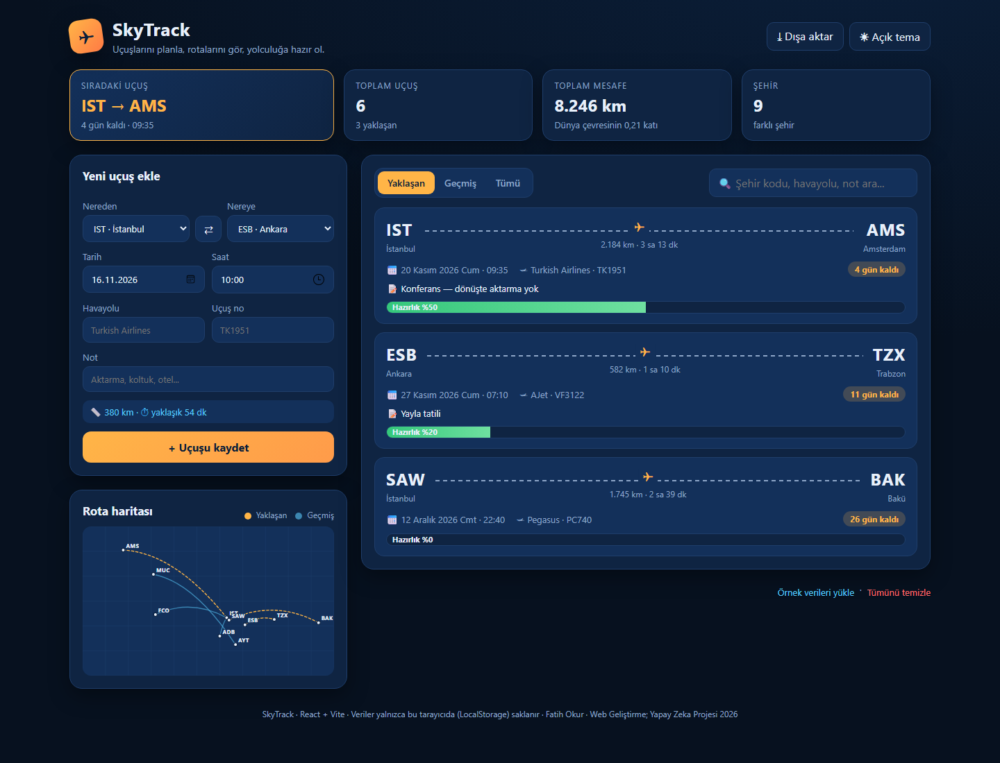

# ✈ SkyTrack — Uçuş ve Seyahat Planlayıcı

**Web Geliştirme; Yapay Zeka — Proje Envanteri** · Fatih Okur · Software Persona Yapay Zeka Mesleki Gelişim Programı 2026

🔗 **Canlı demo:** https://fatihokur.github.io/Software-Persona-Projects/skytrack/
📁 **Kaynak kod:** bu klasör (`02-Web-Gelistirme-Yapay-Zeka`)



## Proje açıklaması

SkyTrack, yolculuk öncesi telaşı azaltmak için tasarlanmış bir uçuş planlayıcı: **uçuşlarını tek yerde planla, rotalarını haritada gör, her uçuş için hazırlık listesini takip et.**
Tüm veriler tarayıcının **LocalStorage** alanında saklanır; sunucu veya hesap gerekmez. Sayfa yenilense de uçuşlar kaybolmaz.

### Özellikler
| Özellik | Açıklama |
|---|---|
| ➕ Uçuş ekleme formu | 29 havalimanı arasından seçim, tarih/saat, havayolu, uçuş no, not; doğrulama (aynı havalimanı, uçuş no biçimi) |
| 📏 Otomatik mesafe ve süre | Haversine formülüyle büyük daire mesafesi ve tahmini uçuş süresi |
| 🗂 Filtre ve arama | Yaklaşan / Geçmiş / Tümü sekmeleri, şehir kodu–havayolu–not içinde anlık arama |
| ⏳ Geri sayım | "4 gün kaldı", "Yarın", "18 gün önce" rozetleri; üstte sıradaki uçuş kartı |
| ✅ Hazırlık listesi | Her uçuşa özel kontrol listesi; yurt dışı uçuşlarda pasaport maddesi otomatik eklenir; madde ekle/sil, ilerleme çubuğu |
| 🗺 Rota haritası | Kütüphanesiz, saf SVG ile çizilen kavisli rotalar (yaklaşan = kesikli turuncu, geçmiş = mavi) |
| 📊 İstatistikler | Toplam uçuş, toplam km (Dünya çevresinin kaç katı), farklı şehir sayısı |
| 🌗 Tema | Koyu / açık tema (tercih LocalStorage'da saklanır) |
| ⤓ Dışa aktarma | Tüm uçuşları JSON dosyası olarak indirme |
| 📱 Duyarlı tasarım | Masaüstü, tablet ve mobil uyumlu |

## Kullanılan teknolojiler
- **React 19** (fonksiyonel bileşenler, `useState`, `useEffect`, `useMemo`, özel `useLocalStorage` hook'u)
- **Vite 7** (geliştirme sunucusu ve üretim derlemesi)
- **Saf CSS** (CSS değişkenleri ile tema, Grid/Flexbox, medya sorguları)
- **LocalStorage** (kalıcı veri)
- **GitHub Actions + GitHub Pages** (otomatik derleme ve yayın)

## Kurulum
```bash
git clone https://github.com/FatihOkur/Software-Persona-Projects.git
cd Software-Persona-Projects/02-Web-Gelistirme-Yapay-Zeka
npm install
npm run dev        # http://localhost:5173
npm run build      # üretim derlemesi → dist/
```

## Proje yapısı
```
src/
├── App.jsx                  # durum yönetimi, filtreleme, düzen
├── hooks/useLocalStorage.js # state ↔ LocalStorage senkronizasyonu
├── data/airports.js         # 29 havalimanı (IATA, şehir, koordinat)
├── data/demo.js             # ilk ziyaret için örnek uçuşlar
├── utils/flight.js          # mesafe, süre, geri sayım, kontrol listesi yardımcıları
├── components/
│   ├── StatsBar.jsx         # özet kartları
│   ├── FlightForm.jsx       # uçuş ekleme formu + doğrulama
│   ├── FlightList.jsx       # sekmeler, arama, liste
│   ├── FlightCard.jsx       # uçuş kartı
│   ├── Checklist.jsx        # hazırlık listesi
│   └── RouteMap.jsx         # SVG rota haritası
└── styles.css               # tema ve duyarlı tasarım
```

## 🤖 Yapay zekanın kullanıldığı aşamalar

Geliştirme sürecinde yapay zeka asistanı olarak **Claude (Claude Code)** kullanıldı.

| Aşama | Yapay zekanın rolü | Örnek istem |
|---|---|---|
| **1. Fikir ve planlama** | Uygulama fikri, ekranlar ve veri modeli birlikte planlandı. Uçuş nesnesinin alanları (`from, to, date, time, airline, flightNo, note, checklist[]`) ve bileşen ağacı çıkarıldı. | *"React ile LocalStorage kullanan bir uçuş planlayıcı tasarlayacağım. Ekranları, bileşen ağacını ve uçuş veri modelini öner."* |
| **2. Bileşen üretimi** | Form, liste, kart ve kontrol listesi bileşenlerinin ilk taslakları üretildi; ben gözden geçirip sadeleştirdim. | *"Kalkış/varış select'leri, tarih-saat alanları ve doğrulaması olan kontrollü bir React form bileşeni yaz. Aynı havalimanı seçilirse hata göstersin."* |
| **3. Algoritma** | Haversine mesafe formülü ve tahmini uçuş süresi hesabı; sonuçlar bilinen mesafelerle (IST–AMS ≈ 2.180 km) doğrulandı. | *"İki enlem-boylam arasındaki büyük daire mesafesini km cinsinden hesaplayan bir JS fonksiyonu yaz ve formülü açıkla."* |
| **4. Görselleştirme** | Kütüphane kullanmadan SVG ile rota haritası: eşdikdörtgen projeksiyon ve kuadratik Bézier eğrileri. | *"Harita kütüphanesi kullanmadan, havalimanı koordinatlarını SVG'ye yansıtıp rotaları kavisli çizgilerle gösteren bir bileşen yaz."* |
| **5. Hata ayıklama** | İlerleme çubuğundaki yazının kırpılması, harita penceresinin çok geniş olması ve ondalık ayırıcının Türkçe olmaması gibi sorunlar ekran görüntüsü üzerinden tespit edilip düzeltildi. | *"Bu ekran görüntüsünde harita rotaları çok küçük görünüyor; projeksiyon sınırlarını nasıl ayarlamalıyım?"* |
| **6. Stil önerisi** | Koyu/açık tema için CSS değişken paleti ve duyarlı kırılım noktaları önerildi. | *"Havacılık temalı, lacivert ve turuncu tonlarında, koyu ve açık modu olan bir CSS değişken paleti öner."* |
| **7. Dokümantasyon ve yayın** | README taslağı ve GitHub Pages için GitHub Actions iş akışı oluşturuldu. | *"Vite projesini GitHub Pages'e otomatik yayınlayan bir GitHub Actions workflow'u yaz."* |

**Üretilen kodu nasıl doğruladım?** Her bileşeni tarayıcıda elle test ettim (uçuş ekleme, filtreleme, arama, kontrol listesi, tema). Sayfayı yenileyerek LocalStorage kalıcılığını doğruladım. Mesafeleri bilinen değerlerle karşılaştırdım. Üretim derlemesinin (`npm run build`) hatasız tamamlandığını kontrol ettim.

## Kazanımlar
- HTML, CSS (değişkenler, Grid, Flexbox, medya sorguları) ve modern JavaScript'i (ES modülleri, dizi metotları, `Intl` biçimlendirme) bir arada kullanma
- React bileşen mimarisi, state yönetimi ve özel hook yazma
- Yapay zekaya etkili istem yazma, üretilen kodu değerlendirme ve doğrulama
- Git/GitHub ile sürüm kontrolü ve GitHub Actions ile otomatik yayın
